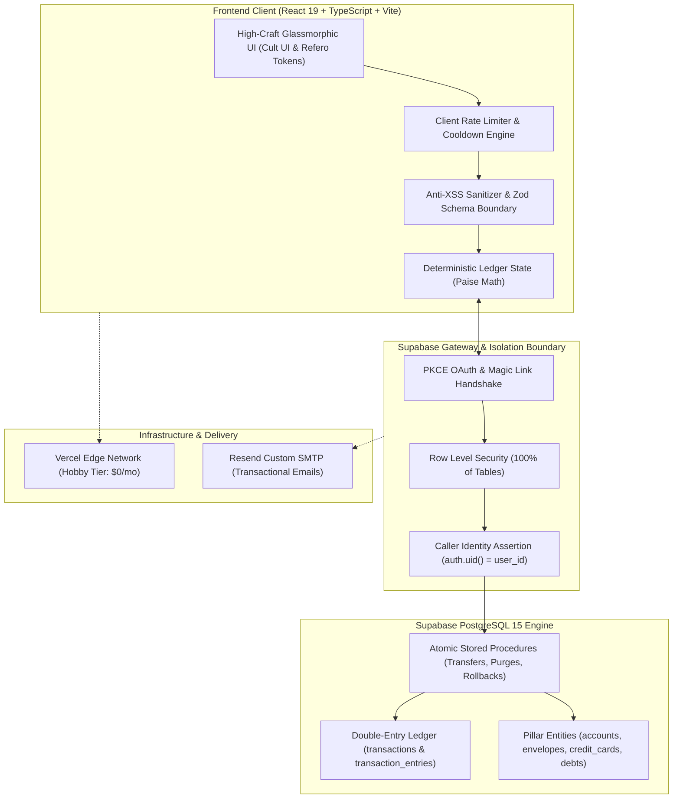

<div align="center">

  

  # Envello

  ### The Deterministic Personal Finance Ledger & Envelope Budgeting Engine

  **Engineered for absolute accounting correctness, strict data isolation, and ₹0/month operating cost.**

  [](https://github.com/JayeshRocks/Envello/actions/workflows/ci.yml)
  [](https://github.com/JayeshRocks/Envello/actions)
  [](https://react.dev/)
  [](https://www.typescriptlang.org/)
  [](https://supabase.com/)
  [](https://tailwindcss.com/)
  [-emerald.svg?style=flat-square)](#-deterministic-math--zero-floating-point-drift)
  [](#-zero-cost-operating-architecture)
  [](LICENSE)

  <p align="center">
    <a href="#-why-envello">Why Envello</a> •
    <a href="#-the-six-financial-pillars">Six Financial Pillars</a> •
    <a href="#-system-architecture">Architecture</a> •
    <a href="#-core-capabilities">Capabilities</a> •
    <a href="#-security--privacy-invariants">Security & Privacy</a> •
    <a href="#-getting-started">Getting Started</a> •
    <a href="#-documentation-architecture">Docs</a>
  </p>

</div>

---

## 🌟 Why Envello?

Most personal finance apps suffer from two fatal engineering defects that erode user trust:

```
┌───────────────────────────────────────┐       ┌───────────────────────────────────────┐
│     Standard Personal Finance Apps    │       │                ENVELLO                │
├───────────────────────────────────────┤       ├───────────────────────────────────────┤
│ ❌ Single Ambiguous "Total Balance"   │       │ ✅ Explicit 6-Pillar Balance Taxonomy │
│    Conflates card limits, locked FDs, │       │    Spendable cash is never conflated  │
│    and cash into one misleading sum.  │       │    with credit debt or locked assets. │
├───────────────────────────────────────┤       ├───────────────────────────────────────┤
│ ❌ IEEE 754 Floating-Point Math Drift │       │ ✅ 100% Deterministic Integer Paise   │
│    `0.1 + 0.2 = 0.30000000000000004`  │       │    `10 paise + 20 paise = 30 paise`   │
│    compounds rounding ledger errors.  │       │    Every calculation is provably exact│
├───────────────────────────────────────┤       ├───────────────────────────────────────┤
│ ❌ Expensive SaaS Subscriptions       │       │ ✅ ₹0/Month Operating Footprint      │
│    Requires paid APIs and recurring   │       │    Operates entirely within free-tier │
│    cloud subscriptions.               │       │    serverless infrastructure.         │
└───────────────────────────────────────┘       └───────────────────────────────────────┘
```

---

## 🏛️ The Six Financial Pillars

Envello provides mathematical certainty by categorizing every rupee into six authoritative financial pillars:

| # | Pillar | Classification | Behavioral Rule |
| :-: | :--- | :--- | :--- |
| **1** | **Spendable Cash** | Liquid Asset | Actual spendable money across checking accounts, savings accounts, and physical cash. |
| **2** | **Envelope Allocations** | Assigned Funds | Cash assigned to digital envelopes (Groceries, Utilities, Subscriptions, Dining) for current-month spending. |
| **3** | **Savings & Fixed Deposits** | Locked Asset | Term deposits, emergency funds, and long-term reserves. Strictly non-spendable without explicit liquidation. |
| **4** | **Credit Card Liabilities** | Unsettled Debt | Outstanding card balances representing debts owed to issuing banks. Monitored against credit limits. |
| **5** | **Actual Debts** | Counterparty Debt | Money borrowed from or lent to family, friends, or institutions with dedicated repayment ledgers. |
| **6** | **Monthly Targets** | Planning Goals | Financial goals you intend to fund during the month. Targets are planning intentions, never liquid cash. |

---

## 🏗️ System Architecture

Envello follows an authoritative database-first architecture. UI components never invent ad-hoc balances that bypass persisted double-entry transactions.



---

## 📐 Deterministic Math & Zero Floating-Point Drift

Financial trust is destroyed when numbers drift. Envello completely eliminates standard JavaScript IEEE 754 floating-point numbers from financial arithmetic:

```typescript
// ❌ Standard JavaScript float arithmetic (Unsafe for financial ledgers):
0.1 + 0.2 === 0.30000000000000004 // true

// ✅ Envello integer paise arithmetic (Exact & Deterministic):
const itemA: bigint = 10n; // 10 paise (₹0.10)
const itemB: bigint = 20n; // 20 paise (₹0.20)
itemA + itemB === 30n;     // 30 paise (₹0.30) - 100% exact
```

All arithmetic is verified through automated invariant suites covering:
1. **Conservation of Value**: Account transfers debit and credit identical paise amounts simultaneously.
2. **Double-Entry Integrity**: Every transaction creates balanced credit and debit ledger entries.
3. **Credit Utilization Invariants**: Utilization calculations enforce integer bounds and avoid division-by-zero vulnerabilities.

---

## 🚀 Core Capabilities

### ✉️ Digital Envelope Budgeting & Undo Engine
- Assign funds to custom envelopes with responsive icons and category color tokens.
- **1-Click Allocation Undo**: Accidentally budget the wrong amount? Rollback instantly using the integrated snapshot undo engine.
- **Three Month-End Rollover Policies**:
  - `Carry Forward`: Unspent balance rolls directly into next month's envelope.
  - `Sweep to Spendable`: Excess balance sweeps back into Spendable Cash.
  - `Reset`: Allocation resets to ₹0 each billing cycle.

### 💳 Credit Card Utilization Safety
- Track outstanding balances against credit limits with real-time utilization analytics.
- **Safety Threshold Alerts**:
  - 🟢 **Safe** (< 30% utilization)
  - 🟡 **Caution** (30% – 50% utilization)
  - 🔴 **High Risk** (> 50% utilization — impacts credit health)
- Statement payment logging debits liquid accounts and reduces card liabilities in a single atomic transaction.

### 🏦 Fixed Deposits & Zero-Interest Self-EMIs
- **Fixed Deposits**: Principal, interest rates, compounding cycles, and maturity dates with 1-click liquidation back to liquid accounts.
- **Self-EMIs**: Borrow from your own savings for major purchases and enforce disciplined, interest-free monthly repayments to yourself.

### ⏰ Standing Monthly Costs & Subscriptions
- Automate recurring monthly commitments (rent, broadband, insurance, SIPs) with automated due-date alerts and 1-click batch ledger entry.

### ⚖️ Bank Account Reconciliations
- Verify recorded ledger balances against official bank statements with audit logging and variance adjustment tracking.

### 📈 Solvency & Net Worth Analytics
- Real-time solvency health analysis comparing total liquid + locked assets against total liabilities and debt obligations.

---

## 🔒 Security & Privacy Invariants

Envello is designed with defense-in-depth principles:

- **100% Row Level Security (RLS)**: Enforced across every table in PostgreSQL. Cross-user data leakage is mathematically impossible at the database layer.
- **Zero-Trust Client User IDs**: Request bodies or query parameters containing `user_id` are ignored. All database policies derive ownership directly from `auth.uid()`.
- **Anti-XSS & Input Boundaries**: Untrusted strings and payee notes are sanitized and bound by strict Zod schemas with length limits.
- **Brute-Force Rate Limiting**: Exponential backoff cooldowns protect sensitive auth forms.
- **30-Day Account Closure Lifecycle**: Account deletion requests enforce a 30-day grace period with 1-click restoration upon signing in and automated expiration sweeping.
- **Immediate Data Wipe**: Option to bypass the grace period and permanently purge all database records immediately via typed email confirmation.
- **Complete Data Portability**: 1-click export of your complete financial ledger into formatted JSON backup files.

---

## 📱 Mobile & Tablet Ergonomics

- **iOS Safari Auto-Zoom Safeguard**: All form inputs, selects, and textareas enforce `text-base sm:text-sm` (16px on mobile viewports) to eliminate viewport zooming.
- **44px Minimum Touch Targets**: Interactive controls maintain `min-h-[44px] min-w-[44px]` touch targets with tactile feedback.
- **Modal Portals**: Popups render via `ModalPortal` (`createPortal(..., document.body)`) to escape stacking contexts and guarantee viewport centering.
- **Zero Horizontal Scrolling**: Tab strips, quick action pills, and tables use responsive wrapping layouts or fixed-column tables so 100% of controls remain visible on any screen.

---

## 🛠️ Getting Started

### Prerequisites
- **Node.js**: `v20.x` or `v22.x` (Node 22 LTS recommended)
- **npm**: `v10.x` or higher
- **Supabase Account**: Free project on [supabase.com](https://supabase.com)

### 1. Clone the Repository
```bash
git clone https://github.com/JayeshRocks/Envello.git
cd Envello
```

### 2. Install Dependencies
```bash
npm install
```

### 3. Configure Environment Variables
Copy `.env.example` to `.env`:
```bash
cp .env.example .env
```

Configure your Supabase credentials:
```env
VITE_SUPABASE_URL=https://your-project-id.supabase.co
VITE_SUPABASE_ANON_KEY=your-supabase-anon-key
VITE_APP_NAME=Envello
VITE_APP_ENV=development
VITE_APP_URL=http://localhost:5173
```

> [!CAUTION]
> Never place Supabase `service_role` keys or database credentials into client `.env` files. Variables prefixed with `VITE_` are exposed in browser bundles.

### 4. Apply Database Migrations
Apply the migrations located in `supabase/migrations/` sequentially using the Supabase CLI or SQL Editor:
1. `20261025000000_initial_schema.sql` — Core tables, constraints, RLS policies, and transfer RPC.
2. `20261026000000_user_has_password.sql` — Password state helper.
3. `20261026000001_remove_whitelist.sql` — Access gating logic.
4. `20261026000002_profiles_insert_policy.sql` — Profiles insert RLS policy.
5. `20261026000003_generalize_default_envelopes.sql` — Streamlined default envelopes.
6. `20261027000000_delete_user_account.sql` — Cascading account deletion RPC.
7. `20261027000001_account_deletion_grace_period.sql` — 30-day grace period lifecycle & restore RPC.
8. `20261029000000_rename_regular_to_spendable_and_trim_default_envelopes.sql` — Spendable cash taxonomy.
9. `20261031000000_security_hardening.sql` — Caller identity assertion (`auth.uid() = target`), least privilege, and string length check constraints.

### 5. Launch the Development Server
```bash
npm run dev
```
Open [http://localhost:5173](http://localhost:5173) in your browser.

### 6. Run Quality & Build Checks
```bash
# Typecheck and linting
npm run lint

# Run all 53 invariant and security test suites
npm run test

# Production build bundle verification
npm run build
```

---

## 📖 Documentation Architecture

Comprehensive specifications and Architectural Decision Records are maintained in [`docs/`](docs/):

| Document | Purpose |
| :--- | :--- |
| [`docs/PRODUCT_SPEC.md`](docs/PRODUCT_SPEC.md) | Functional product specification across all budgeting, cards, and debt modules. |
| [`docs/ARCHITECTURE.md`](docs/ARCHITECTURE.md) | High-level system architecture, client layers, state management, and Supabase integration. |
| [`docs/DATABASE_DESIGN.md`](docs/DATABASE_DESIGN.md) | Full relational database schema, foreign keys, indexes, and Row Level Security rules. |
| [`docs/ACCOUNTING_RULES.md`](docs/ACCOUNTING_RULES.md) | Invariant accounting rules, transaction taxonomy, and envelope rollover logic. |
| [`docs/SECURITY.md`](docs/SECURITY.md) | Threat model, OAuth configuration, RLS policies, allowlist gating, and pre-launch checklist. |
| [`docs/ROADMAP.md`](docs/ROADMAP.md) | Phased implementation schedule from project initialization to beta testing. |
| [`docs/DEVELOPMENT.md`](docs/DEVELOPMENT.md) | Developer workflow, local Supabase setup, migrations discipline, and coding standards. |
| [`docs/DECISIONS.md`](docs/DECISIONS.md) | Architectural Decision Records (ADRs) explaining key design choices. |
| [`docs/TESTING.md`](docs/TESTING.md) | Testing strategy, 53 invariant verification suites, and release checklists. |

---

## ⚖️ Privacy, Security & Legal Compliance

- **Google OAuth Verification**: Compliant Privacy Policy and Terms of Service endpoints reachable at `/privacy`, `/terms`, `/#privacy`, and `/#terms`.
- **Non-Financial-Advisor Disclaimer**: Envello is an educational, self-directed ledger and envelope-budgeting software tool. It does not provide certified financial, investment, legal, or tax advisory services.
- **Zero Third-Party Advertising**: We do not sell, rent, monetize, or broker financial data to advertisers or third parties.
- **Cloud Sub-Processors**: Financial data is securely hosted on Supabase (AWS eu-central-1 / ap-south-1), transactional emails route through Resend, and web bundles are served via Vercel's Edge Network.
- **User Data Sovereignty**: Users retain the absolute right to export their entire ledger via JSON and request a 30-day grace period account closure or an immediate permanent wipe.

---

## 📄 License & Community

- **License**: [MIT License](LICENSE) — free and open source.
- **Contributing**: See [CONTRIBUTING.md](CONTRIBUTING.md) for contribution guidelines.
- **Code of Conduct**: See [CODE_OF_CONDUCT.md](CODE_OF_CONDUCT.md).
- **Security Policy**: See [SECURITY.md](SECURITY.md).

Copyright © 2026 [Jayesh Yadav](https://github.com/JayeshRocks). All rights reserved.
