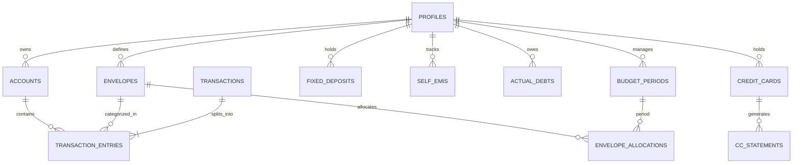

# Envello — Database Design & Schema Specification

## 1. Schema Design Principles

The Envello database schema is designed for relational consistency, strict auditability, and zero data loss on Supabase PostgreSQL:

1. **Exact Currency Representation**: All monetary balances and transaction amounts are stored in integer paise (`BIGINT` where 100 paise = ₹1.00) or `NUMERIC(12, 2)`. Floating-point types (`FLOAT`, `REAL`) are prohibited.
2. **Universal User Scoping**: Every user-owned table contains `user_id UUID NOT NULL REFERENCES auth.users(id) ON DELETE CASCADE`.
3. **Mandatory Row Level Security**: Every table has RLS enabled with explicit policies checking `auth.uid() = user_id`.
4. **Relational Deletion Protection**: Accounts and transaction ledger entries use `ON DELETE RESTRICT` to prevent accidental deletion of financial history.
5. **Atomic Transactions**: Multi-table balance changes are executed within PostgreSQL RPC functions.

---

## 2. Entity-Relationship Overview



---

## 3. Table Definitions & Schemas

### 3.1 `profiles` & Access Gating
```sql
CREATE TABLE IF NOT EXISTS public.profiles (
    id UUID PRIMARY KEY REFERENCES auth.users(id) ON DELETE CASCADE,
    display_name TEXT,
    base_currency TEXT NOT NULL DEFAULT 'INR',
    is_allowlisted BOOLEAN NOT NULL DEFAULT false,
    created_at TIMESTAMPTZ NOT NULL DEFAULT timezone('utc'::text, now()),
    updated_at TIMESTAMPTZ NOT NULL DEFAULT timezone('utc'::text, now())
);

CREATE TABLE IF NOT EXISTS public.allowed_users (
    email TEXT PRIMARY KEY,
    granted_by TEXT,
    created_at TIMESTAMPTZ NOT NULL DEFAULT timezone('utc'::text, now())
);
```

### 3.2 `accounts` (Liquid Bank Accounts & Cash)
```sql
CREATE TABLE IF NOT EXISTS public.accounts (
    id UUID PRIMARY KEY DEFAULT gen_random_uuid(),
    user_id UUID NOT NULL REFERENCES auth.users(id) ON DELETE CASCADE,
    name TEXT NOT NULL,
    institution TEXT NOT NULL,
    account_type TEXT NOT NULL CHECK (account_type IN ('checking', 'savings', 'cash', 'other')),
    balance_paise BIGINT NOT NULL DEFAULT 0,
    is_active BOOLEAN NOT NULL DEFAULT true,
    created_at TIMESTAMPTZ NOT NULL DEFAULT timezone('utc'::text, now()),
    updated_at TIMESTAMPTZ NOT NULL DEFAULT timezone('utc'::text, now())
);
```

### 3.3 `envelopes` & `budget_periods`
```sql
CREATE TABLE IF NOT EXISTS public.envelopes (
    id UUID PRIMARY KEY DEFAULT gen_random_uuid(),
    user_id UUID NOT NULL REFERENCES auth.users(id) ON DELETE CASCADE,
    name TEXT NOT NULL,
    slug TEXT NOT NULL,
    icon TEXT,
    color TEXT,
    is_system_reserved BOOLEAN NOT NULL DEFAULT false, -- e.g. Emergency, Regular
    rollover_policy TEXT NOT NULL DEFAULT 'carry_forward' CHECK (rollover_policy IN ('carry_forward', 'sweep_to_regular', 'reset')),
    created_at TIMESTAMPTZ NOT NULL DEFAULT timezone('utc'::text, now()),
    updated_at TIMESTAMPTZ NOT NULL DEFAULT timezone('utc'::text, now()),
    UNIQUE (user_id, slug)
);

CREATE TABLE IF NOT EXISTS public.budget_periods (
    id UUID PRIMARY KEY DEFAULT gen_random_uuid(),
    user_id UUID NOT NULL REFERENCES auth.users(id) ON DELETE CASCADE,
    period_key TEXT NOT NULL, -- Format: 'YYYY-MM'
    is_closed BOOLEAN NOT NULL DEFAULT false,
    created_at TIMESTAMPTZ NOT NULL DEFAULT timezone('utc'::text, now()),
    UNIQUE (user_id, period_key)
);

CREATE TABLE IF NOT EXISTS public.envelope_allocations (
    id UUID PRIMARY KEY DEFAULT gen_random_uuid(),
    user_id UUID NOT NULL REFERENCES auth.users(id) ON DELETE CASCADE,
    envelope_id UUID NOT NULL REFERENCES public.envelopes(id) ON DELETE RESTRICT,
    period_id UUID NOT NULL REFERENCES public.budget_periods(id) ON DELETE CASCADE,
    allocated_paise BIGINT NOT NULL DEFAULT 0,
    spent_paise BIGINT NOT NULL DEFAULT 0,
    carried_over_paise BIGINT NOT NULL DEFAULT 0,
    created_at TIMESTAMPTZ NOT NULL DEFAULT timezone('utc'::text, now()),
    updated_at TIMESTAMPTZ NOT NULL DEFAULT timezone('utc'::text, now()),
    UNIQUE (user_id, envelope_id, period_id)
);
```

### 3.4 `transactions` & `transaction_entries` (Double-Entry Ledger)
```sql
CREATE TABLE IF NOT EXISTS public.transactions (
    id UUID PRIMARY KEY DEFAULT gen_random_uuid(),
    user_id UUID NOT NULL REFERENCES auth.users(id) ON DELETE CASCADE,
    transaction_date DATE NOT NULL,
    type TEXT NOT NULL CHECK (type IN (
        'income', 'expense', 'transfer', 'envelope_allocation',
        'credit_card_purchase', 'credit_card_payment', 'fd_movement',
        'self_emi_repayment', 'debt_repayment', 'refund', 'adjustment'
    )),
    total_amount_paise BIGINT NOT NULL CHECK (total_amount_paise > 0),
    description TEXT NOT NULL,
    notes TEXT,
    linked_transaction_id UUID REFERENCES public.transactions(id) ON DELETE SET NULL,
    created_at TIMESTAMPTZ NOT NULL DEFAULT timezone('utc'::text, now()),
    updated_at TIMESTAMPTZ NOT NULL DEFAULT timezone('utc'::text, now())
);

CREATE TABLE IF NOT EXISTS public.transaction_entries (
    id UUID PRIMARY KEY DEFAULT gen_random_uuid(),
    transaction_id UUID NOT NULL REFERENCES public.transactions(id) ON DELETE CASCADE,
    user_id UUID NOT NULL REFERENCES auth.users(id) ON DELETE CASCADE,
    account_id UUID REFERENCES public.accounts(id) ON DELETE RESTRICT,
    envelope_id UUID REFERENCES public.envelopes(id) ON DELETE RESTRICT,
    direction TEXT NOT NULL CHECK (direction IN ('credit', 'debit')),
    amount_paise BIGINT NOT NULL CHECK (amount_paise > 0),
    created_at TIMESTAMPTZ NOT NULL DEFAULT timezone('utc'::text, now())
);
```

### 3.5 `credit_cards` & Statements
```sql
CREATE TABLE IF NOT EXISTS public.credit_cards (
    id UUID PRIMARY KEY DEFAULT gen_random_uuid(),
    user_id UUID NOT NULL REFERENCES auth.users(id) ON DELETE CASCADE,
    card_name TEXT NOT NULL,
    issuer TEXT NOT NULL,
    credit_limit_paise BIGINT NOT NULL CHECK (credit_limit_paise > 0),
    outstanding_balance_paise BIGINT NOT NULL DEFAULT 0,
    statement_day INT NOT NULL CHECK (statement_day BETWEEN 1 AND 31),
    payment_due_day INT NOT NULL CHECK (payment_due_day BETWEEN 1 AND 31),
    warning_threshold_percent INT NOT NULL DEFAULT 30 CHECK (warning_threshold_percent BETWEEN 1 AND 100),
    is_active BOOLEAN NOT NULL DEFAULT true,
    created_at TIMESTAMPTZ NOT NULL DEFAULT timezone('utc'::text, now()),
    updated_at TIMESTAMPTZ NOT NULL DEFAULT timezone('utc'::text, now())
);

CREATE TABLE IF NOT EXISTS public.credit_card_statements (
    id UUID PRIMARY KEY DEFAULT gen_random_uuid(),
    card_id UUID NOT NULL REFERENCES public.credit_cards(id) ON DELETE CASCADE,
    user_id UUID NOT NULL REFERENCES auth.users(id) ON DELETE CASCADE,
    statement_date DATE NOT NULL,
    due_date DATE NOT NULL,
    statement_balance_paise BIGINT NOT NULL,
    minimum_payment_paise BIGINT NOT NULL DEFAULT 0,
    is_settled BOOLEAN NOT NULL DEFAULT false,
    created_at TIMESTAMPTZ NOT NULL DEFAULT timezone('utc'::text, now())
);
```

### 3.6 `fixed_deposits` (Savings Assets)
```sql
CREATE TABLE IF NOT EXISTS public.fixed_deposits (
    id UUID PRIMARY KEY DEFAULT gen_random_uuid(),
    user_id UUID NOT NULL REFERENCES auth.users(id) ON DELETE CASCADE,
    institution TEXT NOT NULL, -- e.g. Bank / NBFC / Post Office
    principal_paise BIGINT NOT NULL CHECK (principal_paise > 0),
    interest_rate_percent NUMERIC(5, 2) NOT NULL,
    start_date DATE NOT NULL,
    maturity_date DATE NOT NULL,
    maturity_amount_paise BIGINT NOT NULL,
    is_liquidated BOOLEAN NOT NULL DEFAULT false,
    created_at TIMESTAMPTZ NOT NULL DEFAULT timezone('utc'::text, now()),
    updated_at TIMESTAMPTZ NOT NULL DEFAULT timezone('utc'::text, now())
);
```

### 3.7 `self_emis` & `actual_debts`
```sql
CREATE TABLE IF NOT EXISTS public.self_emis (
    id UUID PRIMARY KEY DEFAULT gen_random_uuid(),
    user_id UUID NOT NULL REFERENCES auth.users(id) ON DELETE CASCADE,
    description TEXT NOT NULL,
    total_funded_paise BIGINT NOT NULL CHECK (total_funded_paise > 0),
    monthly_reimbursement_paise BIGINT NOT NULL CHECK (monthly_reimbursement_paise > 0),
    total_reimbursed_paise BIGINT NOT NULL DEFAULT 0,
    start_date DATE NOT NULL,
    is_completed BOOLEAN NOT NULL DEFAULT false,
    created_at TIMESTAMPTZ NOT NULL DEFAULT timezone('utc'::text, now()),
    updated_at TIMESTAMPTZ NOT NULL DEFAULT timezone('utc'::text, now())
);

CREATE TABLE IF NOT EXISTS public.actual_debts (
    id UUID PRIMARY KEY DEFAULT gen_random_uuid(),
    user_id UUID NOT NULL REFERENCES auth.users(id) ON DELETE CASCADE,
    lender_name TEXT NOT NULL,
    initial_debt_paise BIGINT NOT NULL CHECK (initial_debt_paise > 0),
    remaining_debt_paise BIGINT NOT NULL,
    monthly_instalment_paise BIGINT NOT NULL,
    due_date DATE,
    is_settled BOOLEAN NOT NULL DEFAULT false,
    created_at TIMESTAMPTZ NOT NULL DEFAULT timezone('utc'::text, now()),
    updated_at TIMESTAMPTZ NOT NULL DEFAULT timezone('utc'::text, now())
);
```

### 3.8 `monthly_targets`
```sql
CREATE TABLE IF NOT EXISTS public.monthly_targets (
    id UUID PRIMARY KEY DEFAULT gen_random_uuid(),
    user_id UUID NOT NULL REFERENCES auth.users(id) ON DELETE CASCADE,
    title TEXT NOT NULL,
    target_amount_paise BIGINT NOT NULL CHECK (target_amount_paise > 0),
    target_date DATE NOT NULL,
    current_contributed_paise BIGINT NOT NULL DEFAULT 0,
    is_achieved BOOLEAN NOT NULL DEFAULT false,
    created_at TIMESTAMPTZ NOT NULL DEFAULT timezone('utc'::text, now()),
    updated_at TIMESTAMPTZ NOT NULL DEFAULT timezone('utc'::text, now())
);
```

### 3.9 `audit_logs`
```sql
CREATE TABLE IF NOT EXISTS public.audit_logs (
    id UUID PRIMARY KEY DEFAULT gen_random_uuid(),
    user_id UUID NOT NULL REFERENCES auth.users(id) ON DELETE CASCADE,
    entity_name TEXT NOT NULL,
    entity_id UUID NOT NULL,
    action TEXT NOT NULL CHECK (action IN ('CREATE', 'UPDATE', 'DELETE', 'ADJUSTMENT')),
    old_state JSONB,
    new_state JSONB,
    reason TEXT,
    created_at TIMESTAMPTZ NOT NULL DEFAULT timezone('utc'::text, now())
);
```

---

## 4. Row Level Security Policies (Standard Pattern)

Every table applies the following standard policy pattern:

```sql
-- Enable RLS
ALTER TABLE public.accounts ENABLE ROW LEVEL SECURITY;

-- Select policy
CREATE POLICY "Users can only read own accounts"
    ON public.accounts FOR SELECT
    USING (auth.uid() = user_id);

-- Insert policy
CREATE POLICY "Users can only insert own accounts"
    ON public.accounts FOR INSERT
    WITH CHECK (auth.uid() = user_id);

-- Update policy
CREATE POLICY "Users can only update own accounts"
    ON public.accounts FOR UPDATE
    USING (auth.uid() = user_id)
    WITH CHECK (auth.uid() = user_id);

-- Delete policy
CREATE POLICY "Users can only delete own accounts"
    ON public.accounts FOR DELETE
    USING (auth.uid() = user_id);
```

---

## 5. Atomic RPC Functions (Examples)

### Account-to-Account Transfer
```sql
CREATE OR REPLACE FUNCTION public.execute_account_transfer(
    p_from_account_id UUID,
    p_to_account_id UUID,
    p_amount_paise BIGINT,
    p_description TEXT,
    p_date DATE
)
RETURNS UUID
LANGUAGE plpgsql
SECURITY INVOKER
AS $$
DECLARE
    v_user_id UUID := auth.uid();
    v_transaction_id UUID;
BEGIN
    IF v_user_id IS NULL THEN
        RAISE EXCEPTION 'Not authenticated';
    END IF;
    IF p_amount_paise <= 0 THEN
        RAISE EXCEPTION 'Amount must be positive';
    END IF;

    -- Debit source account
    UPDATE public.accounts
    SET balance_paise = balance_paise - p_amount_paise, updated_at = now()
    WHERE id = p_from_account_id AND user_id = v_user_id;
    IF NOT FOUND THEN RAISE EXCEPTION 'Source account not found or unauthorized'; END IF;

    -- Credit destination account
    UPDATE public.accounts
    SET balance_paise = balance_paise + p_amount_paise, updated_at = now()
    WHERE id = p_to_account_id AND user_id = v_user_id;
    IF NOT FOUND THEN RAISE EXCEPTION 'Destination account not found or unauthorized'; END IF;

    -- Record transaction
    INSERT INTO public.transactions (user_id, transaction_date, type, total_amount_paise, description)
    VALUES (v_user_id, p_date, 'transfer', p_amount_paise, p_description)
    RETURNING id INTO v_transaction_id;

    -- Record debit leg
    INSERT INTO public.transaction_entries (transaction_id, user_id, account_id, direction, amount_paise)
    VALUES (v_transaction_id, v_user_id, p_from_account_id, 'debit', p_amount_paise);

    -- Record credit leg
    INSERT INTO public.transaction_entries (transaction_id, user_id, account_id, direction, amount_paise)
    VALUES (v_transaction_id, v_user_id, p_to_account_id, 'credit', p_amount_paise);

    RETURN v_transaction_id;
END;
$$;
```

---

## 4. Chronological Migration Log

| Migration | Purpose & Changes |
| :--- | :--- |
| `20261025000000_initial_schema.sql` | Core relational schema: `profiles`, `accounts`, `envelopes`, `transactions`, `transaction_entries`, `credit_cards`, `fixed_deposits`, `self_emis`, `actual_debts`, atomic transfer RPC, and initial RLS policies. |
| `20261026000000_user_has_password.sql` | Adds user password state helper function. |
| `20261026000001_remove_whitelist.sql` | Updates access gating logic. |
| `20261026000002_profiles_insert_policy.sql` | Hardens user profile insertion RLS. |
| `20261026000003_generalize_default_envelopes.sql` | Seeds streamlined default envelopes upon new profile creation. |
| `20261027000000_delete_user_account.sql` | Introduces cascading account deletion RPC. |
| `20261027000001_account_deletion_grace_period.sql` | Implements 30-day account closure grace period, restoration RPC, and automated purge sweeping. |
| `20261029000000_rename_regular_to_spendable_and_trim_default_envelopes.sql` | Refines envelope taxonomy to match Spendable Cash pillar. |
| `20261031000000_security_hardening.sql` | Security hardening: caller identity assertions (`auth.uid() = target_user_id`) in `purge_user_data`, `REVOKE EXECUTE FROM PUBLIC, anon` on sensitive RPCs, and string length check constraints across all tables. |

