# Envello — Development Roadmap

## Phase Overview

```mermaid
flowchart LR
    P0["Phase 0: Architecture & Specs"] --> P1["Phase 1: Database & RLS"]
    P1 --> P2["Phase 2: Auth & Beta Gating"]
    P2 --> P3["Phase 3: Accounting & Envelopes"]
    P3 --> P4["Phase 4: Transactions & Journal"]
    P4 --> P5["Phase 5: Cards, Debts & FDs"]
    P5 --> P6["Phase 6: Visualizations & Export"]
    P6 --> P7["Phase 7: Security & UI Hardening"]
    P7 -.-> V2["Version 2: AI Assistance (Deferred)"]
```

| Phase | Focus Area | Status |
| :--- | :--- | :--- |
| **Phase 0** | Architecture, Invariant Rules & Specification Architecture | :white_check_mark: Completed |
| **Phase 1** | PostgreSQL Schema, Constraints & RLS Policies | :white_check_mark: Completed |
| **Phase 2** | Supabase Auth (PKCE, OAuth, Magic Link) & Allowlist Gating | :white_check_mark: Completed |
| **Phase 3** | Pure Invariant Accounting Engine & Envelope Rollovers | :white_check_mark: Completed |
| **Phase 4** | Double-Entry Transaction Ledger & Bank Reconciliations | :white_check_mark: Completed |
| **Phase 5** | Credit Cards, Utilization Safety, Fixed Deposits & Self-EMIs | :white_check_mark: Completed |
| **Phase 6** | Solvency Analytics, Net Worth Health & JSON Data Portability | :white_check_mark: Completed |
| **Phase 7** | Full-Stack Security Hardening, Rate Limiting & UI Design Polish | :white_check_mark: Completed |
| **Version 2** | AI-Assisted Categorization & Bank Alert Ingestion | :crystal_ball: Deferred to V2 |

---

## Detailed Phases

### Phase 0: Project Setup & Agent Guidelines (Completed)
- Establish root `AGENTS.md` and `.agents/rules/`.
- Establish Antigravity workflows (`plan-feature`, `implement-feature`, `database-migration`, etc.).
- Complete comprehensive technical documentation suite in `docs/`.
- Configure `.gitignore` and `.env.example`.

---

### Phase 1: Core Foundation & Database Schema
- Initialize Vite + React 19 + TypeScript project with strict type checking.
- Configure Tailwind CSS design tokens for financial color coding and glassmorphism.
- Set up Supabase local development environment and CLI.
- Author versioned database migrations (`supabase/migrations/`):
  - Profiles and allowlist schema.
  - Accounts and envelope tables.
  - Transactions and double-entry ledger entries.
  - Credit cards, statements, fixed deposits, Self EMIs, and actual debts.
  - Enable RLS policies on 100% of tables.

---

### Phase 2: Authentication & Private Beta Gating
- Implement Supabase Auth Google OAuth flow.
- Build login page with clean glassmorphic aesthetic.
- Implement server-enforced allowlist check:
  - Unauthorized Google users receive a quarantined "Access Restricted" screen.
  - Authorized owner email is granted full access to the financial workspace.
- Setup session provider and auth state listeners.

---

### Phase 3: Core Accounting Engine & Envelope Management
- Build pure TypeScript accounting engine in `src/lib/accounting/`:
  - Integer paise conversion helpers.
  - Invariant validator and balance calculators.
  - 100% unit test coverage with Vitest.
- Implement Envelope Management:
  - View default envelopes (Regular, Emergency, Gym, Essentials, Outing, Birthdays, etc.).
  - Budget period selector (`YYYY-MM`).
  - Allocation allocation modal and rollover configurations.

---

### Phase 4: Transactions, Transfers & Reconciliation
- Transaction entry modal:
  - Support Income, Expense, Transfer, Card Purchase, Card Payment, FD Placement.
  - Envelope assignment with Regular as default.
  - Strict input validation via Zod.
- Double-entry atomic RPC functions in Supabase:
  - `execute_account_transfer`
  - `record_card_payment`
  - `record_balance_adjustment`
- Bank statement reconciliation view:
  - Compare calculated ledger balance to actual bank statement.
  - Record audit-logged Balance Adjustments with reasons.

---

### Phase 5: Credit Cards, EMIs & Savings Assets
- Credit card tracking dashboard:
  - Cards list, limits, outstanding balances, utilization gauge (< 30% guideline).
  - Statement closing dates and payment due dates.
- Savings & Fixed Deposits module:
  - Fixed Deposit and term asset tracking (principal, interest, maturity).
  - Non-spendable asset isolation.
- Debt & EMI management:
  - Self EMIs (reimbursements back to savings).
  - Actual debts (external obligations with monthly instalments).

---

### Phase 6: Reporting, Visualizations & Data Export
- Financial overview dashboard featuring the 6 distinct balance pillars.
- Interactive charts (monthly income vs expense, category breakdown, net worth trajectory).
- Personal data export in CSV and JSON formats.

---

### Phase 7: Hardening, Verification & Private Beta Release
- Full accessibility audit (WCAG 2.1 AA, keyboard focus, screen reader announcements).
- Dark mode and light mode contrast verification.
- Deploy frontend to Vercel Hobby tier.
- Execute live smoke test in single-owner private beta.

---

### Version 2: AI Integration (Explicitly Deferred)
- Natural language transaction input ("Spent 450 on lunch with friends").
- SMS and email bank alert parsing.
- Automated receipt scanning and line-item categorization.
- Conversational financial query assistant ("How much did I spend on dining out last quarter?").
